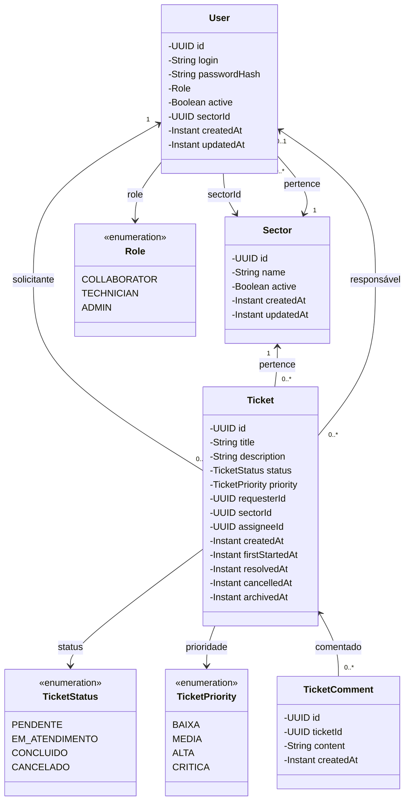

# Diagrama de Classes

## 1. Modelo de Domínio

Este diagrama representa as entidades e conceitos de domínio do sistema.

- **User** representa a identidade do colaborador, autenticação e autorização.
- **Role** Associada a User e é utilizada para autorização.
- **Ticket** representa um chamado criado no contexto Gestão de Chamados

### 2. Relacionamentos do domínio

- **User e Role:** um User pode possuir uma autorização. As roles determinam quais
  funcionalidades o User pode acessar.
- **User e Sector:** um User pertence a um setor da organização.
- **Ticket e User — solicitante:** cada chamado possui um solicitante, representado pelo
  `requesterId`, que referencia exclusivamente `user.id`.
- **Resolução do solicitante na abertura:** em uma operação autenticada, a aplicação obtém o
  `User.id` da identidade autenticada, a atribui o user.id ao requester.id do ticket
- **Responsável pela resolução:** cada chamado pode possuir um responsável, representado pelo
  `assigneeId`, que referencia o identificador do user (Papel de THECNICAL) que irá resolver o
  chamado. O responsável pode ser nulo até a atribuição.
- **Ticket e Sector:** cada chamado pertence a um setor.
- **TicketComment:** registra os comentários associados a um chamado. O autor é associado ao User.
- **Enums:** restringem os valores válidos de roles, status e prioridades.

### 3. Contextos conceituais
O modelo pode ser organizado conceitualmente em três áreas:

| Contexto conceitual                 | Principais conceitos                                |
|-------------------------------------|-----------------------------------------------------|
| **Identidade e Acesso**             | User, Role                                          |
| **Gestão de Organização**           | Sector                                              |
| **Gestão de Chamados**              | Ticket, TicketComment, TicketStatus, TicketPriority |

### 4. Linguagem ubíqua
| Termo             | Significado no domínio                                                                                                    |
|-------------------|---------------------------------------------------------------------------------------------------------------------------|
| **User**          | Identidade/conta de acesso utilizada para autenticação e autorização.                                                     |
| **Role**          | Enum de autorização associado ao User. Define permissões de acesso às funcionalidades do sistema.                         |
| **Administrator** | Papel de autorização representado por `Role.ADMIN`; não é uma entidade de Gestão de Pessoas.                              |
| **Requester**     | User associado à abertura de um chamado.                                                                                  |
| **Assignee**      | User com role de técnico atualmente atribuído ao atendimento de um chamado.                                               |
| **Ticket**        | Solicitação de atendimento registrada no sistema.                                                                         |

v2.5.0