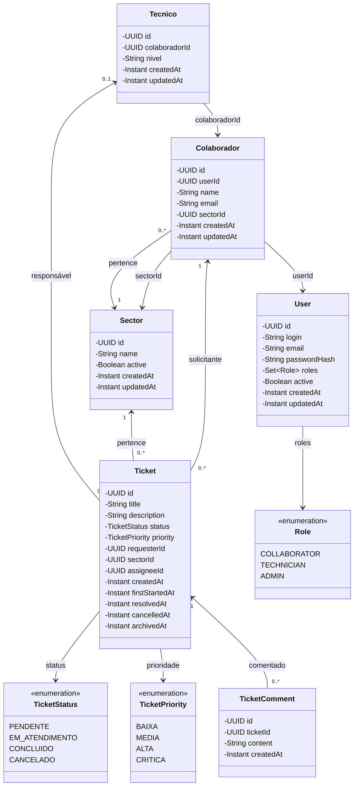

# Diagrama de Classes — Sistema de Chamados

## 1. Modelo de Domínio

Este diagrama representa as entidades e conceitos de domínio do sistema, sem dependências de Spring Boot, JPA ou outras tecnologias de infraestrutura.

A linguagem do domínio distingue **User** das entidades de **Gestão de Pessoas**:

- **User** representa exclusivamente a identidade/conta de acesso, autenticação e autorização.
- **Colaborador** representa uma pessoa da organização no contexto de Gestão de Pessoas e referencia sua conta de acesso por meio de `userId`.
- **Técnico** representa um Colaborador habilitado para realizar atendimento e referencia o Colaborador por meio de `colaboradorId`.
- **Administrador** não é modelado como entidade de Gestão de Pessoas; é uma role de autorização representada por `Role.ADMIN`.
- **Role** permanece associada a User e é utilizada para autenticação/autorização, não para substituir os conceitos de Colaborador e Técnico.

### 2. Relacionamentos do domínio

- **User e Role:** um User pode possuir uma ou mais roles de autorização. As roles determinam quais funcionalidades o User pode acessar.
- **Colaborador e User:** um Colaborador referencia uma conta de acesso por meio de `userId`. O identificador do Colaborador é próprio e não precisa ser igual ao identificador do User.
- **Técnico e Colaborador:** um Técnico referencia um Colaborador por meio de `colaboradorId`. Assim, Técnico representa uma capacidade/função de atendimento de um Colaborador sem transformar `TECHNICIAN` em sua identidade de domínio.
- **Colaborador e Sector:** um Colaborador pertence a um setor da organização.
- **Ticket e Colaborador — solicitante:** cada chamado possui um solicitante, representado pelo `requesterId`, que referencia exclusivamente `Colaborador.id`, nunca `User.id`.
- **Resolução do solicitante na abertura:** em uma operação autenticada, a aplicação obtém o `User.id` da identidade autenticada, localiza o Colaborador por `Colaborador.userId` e utiliza `Colaborador.id` para preencher `Ticket.requesterId`. O cliente não deve escolher livremente o solicitante.
- **Ticket e Técnico — responsável:** cada chamado pode possuir um responsável, representado pelo `assigneeId`, que referencia o identificador do Técnico. O responsável pode ser nulo até a atribuição.
- **Ticket e Sector:** cada chamado pertence a um setor.
- **TicketComment:** registra os comentários associados a um chamado. O autor pode ser associado ao User autenticado no modelo de persistência/aplicação, sem transformar User em entidade responsável pelo domínio do chamado.
- **Enums:** restringem os valores válidos de roles, status e prioridades.

### 3. Contextos conceituais

O modelo pode ser organizado conceitualmente em três áreas:

| Contexto conceitual | Principais conceitos |
|---|---|
| **Identidade e Acesso** | User, Role |
| **Gestão de Pessoas e Organização** | Colaborador, Técnico, Sector |
| **Gestão de Chamados** | Ticket, TicketComment, TicketStatus, TicketPriority |

> **Observação:** esses agrupamentos representam limites conceituais do modelo. Eles não implicam, por si só, que cada grupo precise ser implementado como um Bounded Context ou módulo independente.

### 4. Linguagem ubíqua

| Termo | Significado no domínio |
|---|---|
| **User** | Identidade/conta de acesso utilizada para autenticação e autorização. |
| **Role** | Enum de autorização associado ao User. Define permissões de acesso às funcionalidades do sistema. |
| **Colaborador** | Pessoa da organização representada no contexto de Gestão de Pessoas. Possui referência para um User por meio de `userId`. |
| **Técnico** | Colaborador habilitado para realizar atendimento. Possui referência para Colaborador por meio de `colaboradorId`. |
| **Administrador** | Papel de autorização representado por `Role.ADMIN`; não é uma entidade de Gestão de Pessoas. |
| **Solicitante** | Colaborador associado à abertura de um chamado. |
| **Responsável** | Técnico atualmente atribuído ao atendimento de um chamado. |
| **Chamado** | Solicitação de atendimento registrada no sistema. |
| **Atendimento** | Processo de tratamento de um chamado por um Técnico. |

### 5. Decisão de modelagem

O modelo **não compartilha o mesmo ID entre User e Colaborador**.

A identidade de acesso é independente da identidade de negócio:

`Colaborador.userId -> User.id`

Da mesma forma, Técnico possui sua própria identidade:

`Tecnico.colaboradorId -> Colaborador.id`

Essa decisão mantém separados os conceitos de identidade, autorização e domínio. Também permite que um User exista sem necessariamente representar um Colaborador ou Técnico.

### 6. Implicações para o domínio de chamados

As referências do `Ticket` devem utilizar os identificadores dos conceitos de negócio que representam os participantes do atendimento:

- `requesterId -> Colaborador.id` (não `User.id`)
- `assigneeId -> Tecnico.id`

Na abertura autenticada, o fluxo de resolução é `User autenticado.id -> Colaborador.userId -> Colaborador.id -> Ticket.requesterId`. Assim, User é a origem da identidade autenticada, enquanto Colaborador é o solicitante no domínio de chamados.

A autorização de acesso à operação continua sendo responsabilidade de `User.roles`.

v1.4.0