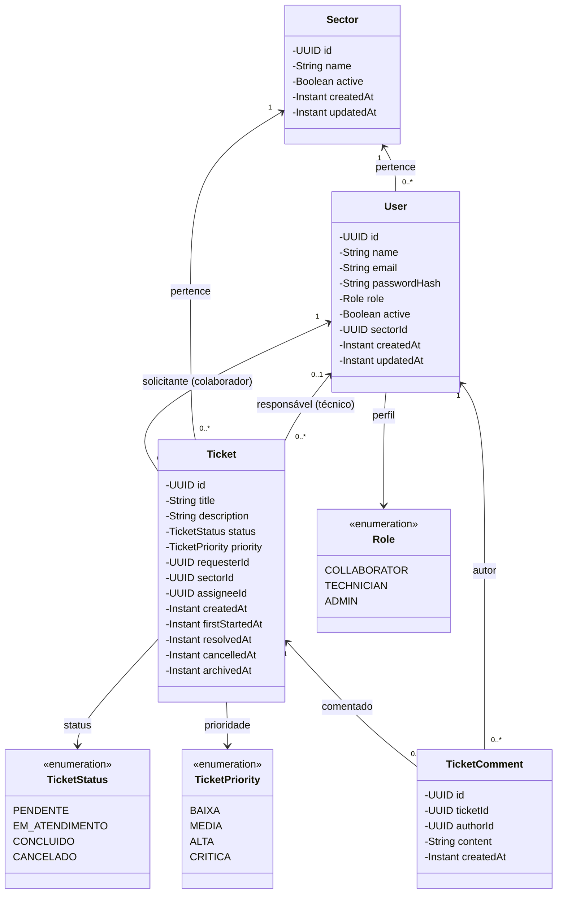

# Diagrama de Classes — Sistema de Chamados

## 1. Modelo de Domínio

Este diagrama representa as entidades de domínio do sistema, sem dependências de Spring Boot, JPA ou outras tecnologias de infraestrutura.

A linguagem do domínio distingue **User**, **Colaborador** e **Técnico**:

- **User** representa a conta de acesso e autenticação.
- **Colaborador** representa o usuário do sistema que solicita atendimento e abre chamados.
- **Técnico** representa o profissional responsável pelo atendimento e resolução dos chamados.
- **Administrador** representa o usuário com responsabilidades administrativas sobre o sistema.

No modelo atual, **Colaborador**, **Técnico** e **Administrador** são papéis desempenhados por um `User`, definidos pelo enum `Role`. Isso evita duplicar a identidade da pessoa no domínio.

### 2. Relacionamentos do domínio

- **User e Role:** um usuário possui um perfil que define seu papel no sistema: colaborador, técnico ou administrador.
- **User e Sector:** um setor pode possuir vários usuários; cada usuário pertence a um setor.
- **Ticket e User — solicitante:** cada chamado possui um solicitante, representado por um usuário com papel de colaborador.
- **Ticket e User — responsável:** cada chamado pode possuir um responsável pelo atendimento, representado por um usuário com papel de técnico. O responsável pode ser nulo até a atribuição.
- **Ticket e Sector:** cada chamado pertence a um setor.
- **TicketComment:** registra os comentários associados a um chamado e o usuário autenticado que os escreveu.
- **Enums:** restringem os valores válidos de papéis, status e prioridades.

### 3. Linguagem ubíqua

| Termo | Significado no domínio |
|---|---|
| **User** | Conta de acesso utilizada para autenticação e identificação do usuário. |
| **Colaborador** | Usuário que solicita atendimento e abre chamados. |
| **Técnico** | Usuário responsável pelo atendimento e resolução dos chamados. |
| **Administrador** | Usuário responsável pela administração do sistema e de suas permissões. |
| **Solicitante** | Colaborador associado à abertura de um chamado. |
| **Responsável** | Técnico atualmente atribuído ao atendimento de um chamado. |
| **Chamado** | Solicitação de atendimento registrada no sistema. |
| **Atendimento** | Processo de tratamento de um chamado por um técnico. |

> Observação: os nomes técnicos dos atributos `requesterId` e `assigneeId` permanecem no código por enquanto. No domínio, seus significados são **solicitante (colaborador)** e **responsável (técnico)**, respectivamente.

v1.1.0
