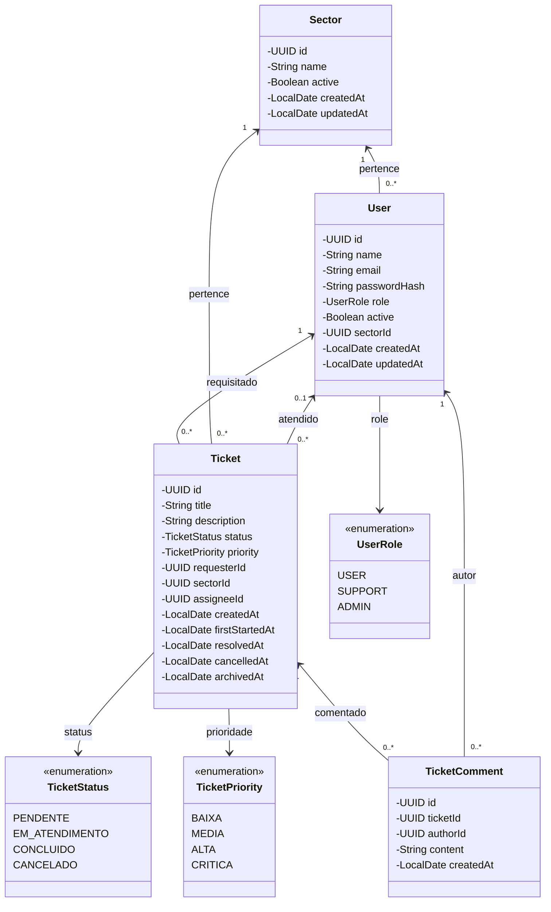

# Diagrama de Classes — Sistema de Chamados

## 1. Modelo de Domínio

Este diagrama representa as entidades de domínio do sistema, sem dependências de Spring Boot, JPA ou outras tecnologias de infraestrutura.

### Relacionamentos do domínio

- **User e Sector:** um setor pode possuir vários usuários; cada usuário pertence a um setor.
- **Ticket e User:** cada chamado possui um solicitante e pode ter um responsável pelo atendimento. O responsável pode ser nulo até a atribuição.
- **Ticket e Sector:** cada chamado pertence a um setor.
- **TicketComment:** registra os comentários associados a um chamado e o usuário que os escreveu.
- **Enums:** restringem os valores válidos de papéis, status, prioridades e tipos de evento.