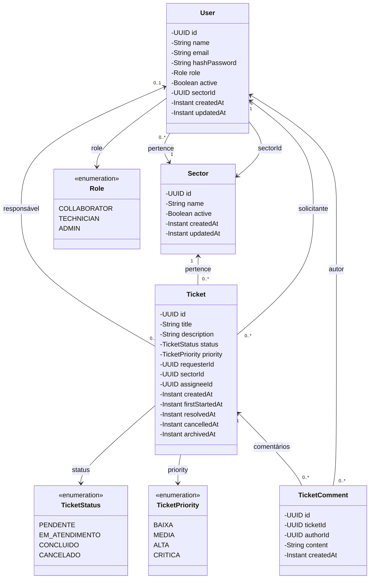

# Diagrama de Classes

## 1. Modelo de Domínio

Este diagrama representa as entidades e conceitos de domínio do sistema.

- **User** representa a pessoa/conta de acesso do Service Desk, incluindo autenticação, autorização e os dados necessários para sua participação na organização.
- **Role** é a autorização associada a um User.
- **Sector** representa uma unidade organizacional.
- **Ticket** representa um chamado criado no contexto de Gestão de Chamados.
- **TicketComment** representa um comentário associado a um Ticket.

O modelo utiliza uma única entidade **User** para representar a identidade de acesso e a pessoa que participa do Service Desk. Não existe uma entidade separada de Colaborador ou Técnico.

O e-mail do User é utilizado como login e cada User possui uma única Role.

### 2. Relacionamentos do domínio

- **User e Role:** cada User possui uma única Role. A Role determina quais funcionalidades o User pode acessar.
- **User e Sector:** um User pode estar associado a um Sector da organização. Enquanto a associação não for realizada, `sectorId` pode permanecer nulo.
- **Ticket e User — solicitante:** cada chamado possui um solicitante, representado pelo `requesterId`, que referencia exclusivamente `User.id`.
- **Resolução do solicitante na abertura:** em uma operação autenticada, a aplicação obtém o `User.id` da identidade autenticada e utiliza esse identificador como `Ticket.requesterId`. O cliente não deve definir livremente o solicitante em operações autenticadas.
- **Responsável pelo atendimento:** cada chamado pode possuir um responsável, representado pelo `assigneeId`, que referencia exclusivamente `User.id`. A aplicação deve validar a Role exigida pela operação antes de atribuir o User como responsável. O responsável pode ser nulo até a atribuição.
- **Ticket e Sector:** cada chamado pertence a um Sector responsável pelo atendimento. O Sector do Ticket não representa necessariamente o Sector ao qual o solicitante pertence.
- **TicketComment e User:** cada comentário possui um autor identificado por `authorId`, que referencia `User.id`.
- **TicketComment e Ticket:** cada comentário pertence a um único Ticket.
- **Enums:** restringem os valores válidos de Role, status e prioridade.

### 3. Contextos conceituais

O modelo pode ser organizado conceitualmente em três áreas:

| Contexto conceitual | Principais conceitos |
|---|---|
| **Identidade e Acesso** | User, Role |
| **Gestão de Organização** | Sector |
| **Gestão de Chamados** | Ticket, TicketComment, TicketStatus, TicketPriority |

> Esses agrupamentos são **contextos conceituais do modelo atual**, e não implicam necessariamente que cada área seja um Bounded Context independente.

### 4. Linguagem ubíqua

| Termo | Significado no domínio |
|---|---|
| **User** | Pessoa/conta de acesso utilizada para autenticação, autorização e participação nas operações do Service Desk. |
| **Role** | Enum de autorização associado ao User. Cada User possui uma única Role. |
| **COLLABORATOR** | Role de acesso do usuário colaborador padrão. |
| **TECHNICIAN** | Role de autorização que permite ao User executar operações de atendimento técnico. Não representa uma entidade separada. |
| **Administrator** | Papel de autorização representado por `Role.ADMIN`; não é uma entidade separada. |
| **Requester** | User associado à abertura de um Ticket. |
| **Assignee** | User atualmente responsável pelo atendimento de um Ticket. |
| **Sector** | Unidade organizacional à qual Users podem pertencer e que pode ser responsável pelo atendimento de Tickets. |
| **Ticket** | Solicitação de atendimento registrada no sistema. |
| **TicketComment** | Comentário registrado em um Ticket por um User. |

### 5. Decisões de modelagem

1. **User é a entidade principal de identidade e participação organizacional no contexto do Service Desk.**
2. **Não existe herança `Collaborator extends User`**, pois não existe uma especialização de entidade necessária no modelo atual.
3. **Não existe entidade Técnico.** A capacidade de executar operações técnicas é representada pela `Role.TECHNICIAN`.
4. **Não existe entidade Administrador.** A capacidade administrativa é representada pela `Role.ADMIN`.
5. **Requester e Assignee não são entidades.** São papéis contextuais que um User pode desempenhar em um Ticket.
6. **`Ticket.requesterId` e `Ticket.assigneeId` referenciam `User.id`.**
7. **O e-mail é o login do User** e deve ser único.
8. **Cada User possui uma única Role.**
9. O setor do User e o setor do Ticket representam relações diferentes e não devem ser tratados como equivalentes.

#### *v2.6.0*
