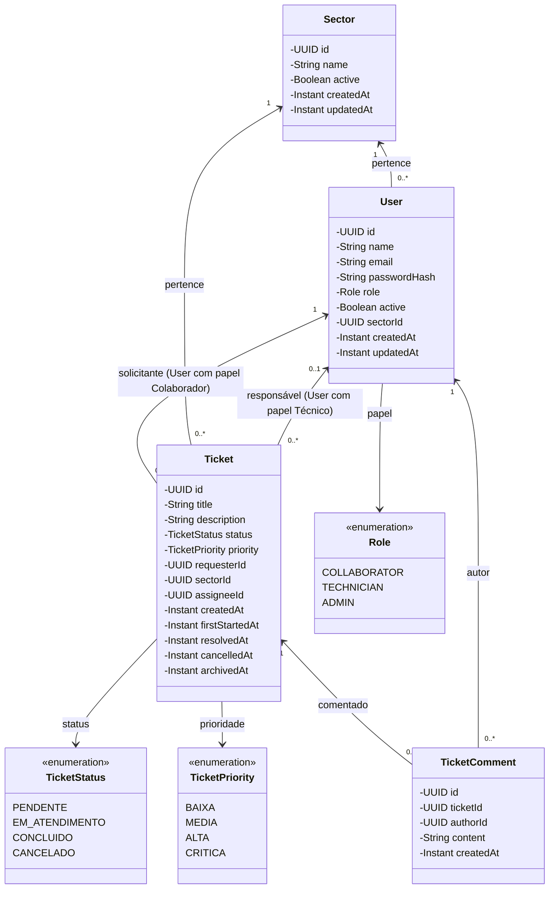

# Diagrama de Classes — Sistema de Chamados

## 1. Modelo de Domínio

Este diagrama representa as entidades de domínio do sistema, sem dependências de Spring Boot, JPA ou outras tecnologias de infraestrutura.

A linguagem do domínio distingue **User** dos papéis de negócio **Colaborador**, **Técnico** e **Administrador**:

- **User** representa exclusivamente a identidade/conta de acesso e autenticação.
- **Colaborador** é o papel de negócio de um User que solicita atendimento e abre chamados.
- **Técnico** é o papel de negócio de um User responsável pelo atendimento e resolução dos chamados.
- **Administrador** é o papel de negócio de um User responsável pela administração do sistema e de suas permissões.

**Colaborador, Técnico e Administrador não são entidades distintas de User.** São papéis atribuídos a um User por meio do enum `Role`. Dessa forma, uma única identidade é utilizada para autenticação e para representar sua atuação no domínio.

### 2. Relacionamentos do domínio

- **User e Role:** um User possui um papel que define sua atuação e suas permissões no sistema: Colaborador, Técnico ou Administrador.
- **User e Sector:** um setor pode possuir vários Users; cada User pertence a um setor.
- **Ticket e User — solicitante:** cada chamado possui um solicitante. O solicitante é um User cujo papel de negócio é **Colaborador**.
- **Ticket e User — responsável:** cada chamado pode possuir um responsável pelo atendimento. O responsável é um User cujo papel de negócio é **Técnico**. O responsável pode ser nulo até a atribuição.
- **Ticket e Sector:** cada chamado pertence a um setor.
- **TicketComment:** registra os comentários associados a um chamado e o User autenticado que os escreveu.
- **Enums:** restringem os valores válidos de papéis, status e prioridades.

### 3. Linguagem ubíqua

| Termo | Significado no domínio |
|---|---|
| **User** | Identidade/conta de acesso utilizada para autenticação. |
| **Colaborador** | Papel de negócio de um User que solicita atendimento e abre chamados. |
| **Técnico** | Papel de negócio de um User responsável pelo atendimento e resolução dos chamados. |
| **Administrador** | Papel de negócio de um User responsável pela administração do sistema e de suas permissões. |
| **Solicitante** | Colaborador associado à abertura de um chamado. |
| **Responsável** | Técnico atualmente atribuído ao atendimento de um chamado. |
| **Chamado** | Solicitação de atendimento registrada no sistema. |
| **Atendimento** | Processo de tratamento de um chamado por um Técnico. |

> **Observação:** `requesterId` e `assigneeId` continuam representando referências a `User`. No domínio, seus significados são **Solicitante (Colaborador)** e **Responsável (Técnico)**, respectivamente. Colaborador e Técnico não são entidades separadas de User.

v1.2.0